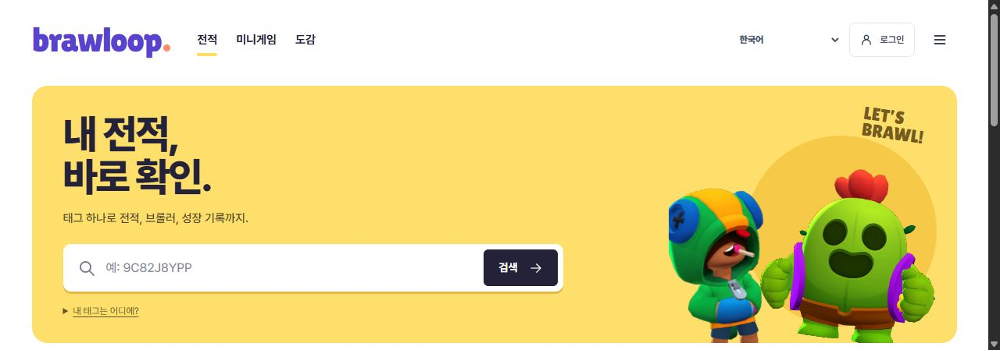
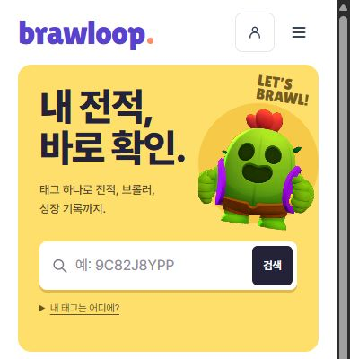

# Brawloop · 브롤루프

**내 전적을 확인하고, 브롤 퀴즈 한 판.**

Brawl Stars stats, Brawler quizzes, and player comparison — in 10 languages.

Brawloop는 플레이어 태그로 전적과 브롤러 육성 현황을 확인하고, 친구와 비교하거나 미니게임을 즐길 수 있는 브롤스타즈 팬 서비스입니다. 기존 **Brawl Status KR**에서 이름과 화면을 개편했습니다.

[사이트 열기](https://www.brawl-o1.site/) · [English](https://www.brawl-o1.site/en) · [미니게임](https://www.brawl-o1.site/minigames) · [친구와 비교](https://www.brawl-o1.site/compare)

## 주요 기능

| 기능 | 할 수 있는 일 |
| --- | --- |
| 전적 검색 | 프로필, 트로피, 경쟁전, 최근 최대 25경기의 승패·모드별 기록 확인 |
| 브롤러 육성 | 보유 브롤러의 파워 레벨·장비, 강화 진행률과 남은 강화 비용 확인 |
| 기록과 비교 | 저장된 조회 기록을 바탕으로 트로피 변화·활동을 확인하고 두 플레이어 비교 |
| 맵·팀·카운터 | 서비스에서 수집한 전투 표본으로 추천과 조합 통계 확인 |
| 도감과 스킨 | 브롤러·맵·모드·이벤트·스킨 정보 탐색, 현재 착용 스킨 확인 |
| 미니게임 6종 | 브롤러 이름, 실루엣, 능력치 비교, 맵 이름, 능력 주인, 출시 순서 퀴즈 |
| 선택적 계정 | Google 로그인, 기본 플레이어 태그, 개인 대시보드와 미니게임 개인 최고 기록 동기화 |

전적 검색과 미니게임은 로그인 없이 이용할 수 있습니다. 최근 검색·즐겨찾기는 브라우저에 저장하며, 계정 기능과 최고 기록 동기화는 운영 설정에 따라 활성화됩니다.

기록은 조회·저장된 데이터가 기준입니다. 모든 플레이어를 상시 추적하거나, 전체 보유 스킨을 항상 확인할 수 있는 서비스는 아닙니다. 추가 보유 스킨 조회는 별도로 활성화한 보조 제공자의 응답 범위에 따릅니다.

## 화면

노랑·보라 색상, Brawloop 워드마크와 게임 이미지로 전적 검색·미니게임·도감을 구분합니다. 모바일에서는 전체 메뉴로 다른 기능에 접근할 수 있습니다.

| 데스크톱 검색 화면 | 모바일 검색 화면 |
| --- | --- |
|  |  |

2026년 10월 개편 후 실제 서비스의 검색 영역입니다.

## 미니게임

| 게임 | 플레이 |
| --- | --- |
| 브롤러 이름 맞히기 | [기억나는 브롤러 이름 입력하기](https://www.brawl-o1.site/minigames/brawler-quiz) |
| 실루엣 퀴즈 | [그림자만 보고 브롤러 맞히기](https://www.brawl-o1.site/minigames/silhouette-quiz) |
| Higher or Lower | [두 브롤러의 능력치 비교하기](https://www.brawl-o1.site/minigames/higher-lower) |
| 맵 이름 맞히기 | [맵 이미지를 보고 이름 고르기](https://www.brawl-o1.site/minigames/map-quiz) |
| 가젯·스타파워 주인 맞히기 | [능력의 주인 찾기](https://www.brawl-o1.site/minigames/ability-quiz) |
| 브롤러 출시 순서 | [먼저 출시된 브롤러 고르기](https://www.brawl-o1.site/minigames/release-order) |

구성·기록·데이터 갱신 방식은 [미니게임 문서](docs/MINIGAMES.md)에 있습니다.

## 지원 언어

한국어, 영어, 일본어, 브라질 포르투갈어, 스페인어, 튀르키예어, 독일어, 프랑스어, 이탈리아어, 러시아어를 지원합니다.

한국어 기본 경로는 `/`이며, 다른 언어는 `/en`, `/ja`, `/pt-br` 같은 접두 경로를 사용합니다. 첫 방문은 저장된 언어 선택과 브라우저 언어를 참고하며, 메뉴에서 직접 바꿀 수 있습니다.

## 데이터 기준

메타 통계는 전체 Brawl Stars 이용자의 공식 통계가 아닙니다. 이 서비스에서 검색된 플레이어의 최근 전투를 누적한 표본이므로 지역·실력대·검색 빈도에 따른 편향이 있습니다.

- 같은 플레이어의 전투는 시간과 전투 지문을 기준으로 중복 저장을 방지합니다.
- 일반 2팀 전투는 같은 전투 지문을 한 번만 고른 뒤 양 팀 참가자를 펼쳐 계산합니다.
- 듀오·트리오 쇼다운은 상대 팀의 결과를 추정하지 않고 검색된 플레이어 관점의 순위를 사용합니다.
- 친선전은 통계에서 제외합니다. 맵·브롤러 조합은 최소 5판일 때만 노출합니다.
- 메타 집계 스냅샷은 15분마다 갱신하고 조회 결과는 5분 캐시합니다. 45분 이상 오래된 집계는 조회 오류로 안내합니다.
- 저장된 고유 태그 수와 방문자 수는 서로 다른 지표입니다.

자세한 계산식과 한계는 [데이터 산정 방식](docs/DATA_METHODOLOGY.md)을 확인하세요.

## 기술 스택

- Next.js 16 · React 19 · TypeScript
- Tailwind CSS 4 · CSS Modules
- PostgreSQL · Drizzle ORM · Better Auth
- Vitest · Playwright · ESLint
- Vercel

구조와 운영 절차는 [아키텍처](docs/ARCHITECTURE.md), [운영 가이드](docs/OPERATIONS.md)에 정리했습니다.

## 로컬 실행

Node.js 20 이상, npm, 개발용 PostgreSQL과 Brawl Stars Developer API 키가 필요합니다. 아래 명령은 Windows PowerShell 기준이며, 다른 셸에서는 `npm.cmd` 대신 `npm`을 사용하면 됩니다.

```powershell
git clone https://github.com/psh1234567890/brawl_status_kr.git
cd brawl_status_kr
npm.cmd ci
Copy-Item .env.example .env.local
```

`.env.local`에 본인의 **개발용** DB 연결과 API 설정을 입력한 뒤 실행합니다.

```powershell
npm.cmd run db:migrate
npm.cmd run db:check
npm.cmd run dev
```

[http://localhost:3000](http://localhost:3000)에서 확인할 수 있습니다. 상세 설정과 마이그레이션 절차는 [직접 실행 가이드](docs/SELF_HOSTING.md)를 참고하세요.

### 주요 환경 변수

| 이름 | 용도 |
| --- | --- |
| `DATABASE_URL` | 앱 런타임 PostgreSQL 연결 |
| `DIRECT_URL` | DB 점검·마이그레이션에 사용할 직접 연결 |
| `BRAWL_STARS_API_KEY` | 서버 전용 Brawl Stars API 키 |
| `BRAWL_STARS_API_BASE_URL` | 공식 API 또는 직접 관리하거나 명시적으로 신뢰한 HTTPS 프록시 |
| `ACCOUNTS_MODE` | 계정 기능 모드. 기본값은 `off` |
| `ACCOUNT_SYNC_ENABLED` | 계정별 미니게임 최고 기록 동기화 스위치. 기본값은 `0` |
| `BRAWLACE_SKIN_LOOKUP_ENABLED` | 추가 보유 스킨 보조 조회. 기본값은 `false` |
| `BRAWLACE_JINA_READER_ENABLED` | Brawlace 직접 조회 실패 시 Reader 사용. 기본값은 `false` |
| `NEXT_PUBLIC_ADSENSE_CLIENT_ID` / `NEXT_PUBLIC_ADSENSE_SLOT_ID` | 선택적 광고 설정 |

실제 키와 DB 연결 값을 커밋하지 마세요. API 서버 주소에는 묵시적 기본 프록시가 없으며 운영자가 명시해야 합니다. 광고는 client ID와 slot ID가 함께 있어야 광고 슬롯을 표시합니다.

전체 변수와 기본값은 [.env.example](.env.example)에 있습니다. Google OAuth·계정 정책·계정 전용 마이그레이션은 [계정 릴리스 준비](docs/ACCOUNT_RELEASE_READINESS.md), 대시보드는 [계정 대시보드](docs/ACCOUNT_DASHBOARD.md), 광고 설정은 [AdSense 운영 준비](docs/ADSENSE.md)를 참고하세요.

## 검증과 데이터 갱신

```powershell
npm.cmd run lint
npm.cmd run test
npm.cmd run build
npm.cmd run test:e2e
```

CI는 운영 API 키와 운영 DB 없이 린트·단위 테스트·의존성 점검·빌드를 실행합니다. 계정 마이그레이션과 백업·복구 검증에는 임시 PostgreSQL을 사용하고, 전적·미니게임·계정 흐름은 테스트 데이터로 확인합니다.

번역 카탈로그와 미니게임 에셋은 다음 명령으로 갱신합니다.

```powershell
npm.cmd run translations:ja:update
npm.cmd run translations:additional:update
npm.cmd run minigames:assets:update
```

## 출처와 라이선스

프로젝트가 직접 작성한 소스 코드와 문서는 [MIT License](LICENSE)로 공개합니다. 외부 데이터·게임 이미지·글꼴의 권리는 각 제공자의 조건을 따릅니다.

- **Brawl Stars API**: 공개 프로필·전투·클럽·랭킹과 현재 착용 스킨.
- **BrawlAPI / Brawlify**: 맵·모드·브롤러·이벤트 데이터, 번역·스킨 카탈로그 원본과 이미지 CDN.
- **Brawlace / Jina Reader**: 운영자가 별도로 활성화한 보유 스킨 보조 조회.
- **Pretendard / Lilita One**: 자체 호스팅 글꼴. 각 [글꼴 라이선스](public/fonts/brand/)를 포함합니다.

상세 출처는 [THIRD_PARTY_NOTICES.md](THIRD_PARTY_NOTICES.md)에 있습니다. Brawloop는 Supercell의 승인·후원·제휴를 받지 않은 비공식 팬 프로젝트이며, 관련 명칭·이미지·게임 데이터는 각 권리자에게 속합니다. [Supercell Fan Content Policy](https://supercell.com/en/fan-content-policy/)를 확인하세요.

## 기여와 문의

버그·번역·문서 오류·기능 제안·데이터 정확성 제보는 [GitHub Issues](https://github.com/psh1234567890/brawl_status_kr/issues)로 남겨주세요. 기여 절차는 [CONTRIBUTING.md](CONTRIBUTING.md), 지원 범위는 [SUPPORT.md](SUPPORT.md)에 있습니다.

보안 취약점은 공개 이슈 대신 [SECURITY.md](SECURITY.md)의 비공개 신고 절차를 이용해 주세요. 실제 플레이어 정보, 운영 DB 덤프, API 키와 `.env` 파일은 이슈·PR·테스트 데이터에 포함하지 않습니다.

개인정보 처리와 측정 원칙은 [개인정보 안내](docs/PRIVACY.md), 예정 작업과 변경 이력은 [로드맵](docs/ROADMAP.md)과 [CHANGELOG.md](CHANGELOG.md)에서 확인할 수 있습니다.
